# Database Design & Relational Schema Specification
## Alumni Connect Portal — AI-Powered Alumni Networking, Mentorship & Career Platform

---

### 1. Entity-Relationship (ER) Diagram

The diagram below documents the complete relational schema implemented in **MySQL 8.0** for the Alumni Connect Portal.

```mermaid
erDiagram
    users ||--o| profiles : "has 1:1"
    users ||--o| student_details : "has 1:1 (role=STUDENT)"
    users ||--o| alumni_details : "has 1:1 (role=ALUMNI)"
    users ||--o| mentor_profiles : "has 1:1 (role=ALUMNI)"
    users ||--o{ mentor_availability_slots : "schedules slots"
    users ||--o{ mentorship_bookings : "books as student"
    users ||--o{ jobs : "posts (as alumni/admin)"
    users ||--o{ job_applications : "submits"
    users ||--o{ saved_jobs : "bookmarks"
    users ||--o{ events : "organizes"
    users ||--o{ event_rsvps : "attends"
    users ||--o{ messages : "sends/receives"
    users ||--o{ notifications : "receives"
    users ||--o{ audit_logs : "triggers"

    jobs ||--o{ job_applications : "receives"
    jobs ||--o{ saved_jobs : "bookmarked by"
    events ||--o{ event_rsvps : "has attendees"
    mentor_availability_slots ||--o| mentorship_bookings : "reserved by"

    users {
        int id PK
        string email UK
        string password_hash
        string role "STUDENT | ALUMNI | ADMIN"
        boolean is_active
        boolean is_verified
        datetime created_at
        datetime updated_at
    }

    profiles {
        int id PK
        int user_id FK
        string first_name
        string last_name
        string headline
        text bio
        string avatar_url
        string phone
        string location
        string linkedin_url
        string github_url
        string portfolio_url
        text skills
        datetime created_at
        datetime updated_at
    }

    student_details {
        int id PK
        int user_id FK
        string roll_number UK
        int current_year
        string degree
        string department
        int expected_graduation_year
        float cgpa
        text interests
    }

    alumni_details {
        int id PK
        int user_id FK
        int graduation_year
        string degree
        string department
        string current_company
        string current_position
        string industry
        string verification_status "PENDING | VERIFIED | REJECTED"
        string verification_document_url
        datetime verified_at
        int verified_by_admin_id FK
    }

    jobs {
        int id PK
        int poster_id FK
        string title
        string company
        string location
        string job_type "FULL_TIME | PART_TIME | INTERNSHIP | CONTRACT"
        string experience_level "ENTRY | MID | SENIOR"
        text description
        text requirements
        text responsibilities
        string salary_range
        string application_url
        date deadline
        string moderation_status "APPROVED | PENDING | REJECTED"
        boolean is_active
        datetime created_at
    }

    job_applications {
        int id PK
        int job_id FK
        int student_id FK
        string resume_url
        text cover_note
        string status "SUBMITTED | UNDER_REVIEW | SHORTLISTED | REJECTED | ACCEPTED"
        datetime applied_at
    }

    saved_jobs {
        int id PK
        int user_id FK
        int job_id FK
        datetime created_at
    }

    mentor_profiles {
        int id PK
        int user_id FK
        text expertise_areas
        int experience_years
        int max_monthly_sessions
        text meeting_preferences
        boolean is_accepting_mentees
    }

    mentor_availability_slots {
        int id PK
        int mentor_id FK
        date slot_date
        time start_time
        time end_time
        boolean is_booked
    }

    mentorship_bookings {
        int id PK
        int mentor_id FK
        int student_id FK
        int slot_id FK
        string status "PENDING | CONFIRMED | REJECTED | COMPLETED | CANCELLED"
        datetime session_time
        string meeting_link
        text goal_notes
        text feedback
        int rating
    }

    events {
        int id PK
        int organizer_id FK
        string title
        text description
        string event_type "WEBINAR | WORKSHOP | REUNION | NETWORKING"
        string venue
        string meeting_url
        datetime start_time
        datetime end_time
        int capacity
        string moderation_status
        boolean is_cancelled
    }

    event_rsvps {
        int id PK
        int event_id FK
        int user_id FK
        string status "REGISTERED | CANCELLED"
        datetime registered_at
    }

    messages {
        int id PK
        string conversation_id
        int sender_id FK
        int recipient_id FK
        text content
        boolean is_read
        datetime created_at
    }

    notifications {
        int id PK
        int user_id FK
        string title
        text message
        string notification_type
        string link_url
        boolean is_read
        datetime created_at
    }

    audit_logs {
        int id PK
        int actor_id FK
        string action
        string entity_type
        int entity_id
        json details
        string ip_address
        datetime created_at
    }
```



---

### 2. Relational Table Specifications & Constraints

| Table Name | Primary Key | Foreign Keys | Key Constraints & Indexes |
| :--- | :--- | :--- | :--- |
| `users` | `id` (INT AUTO_INCREMENT) | None | `UNIQUE(email)`, `INDEX(role, is_active)` |
| `profiles` | `id` (INT AUTO_INCREMENT) | `user_id` &rarr; `users.id` (CASCADE) | `UNIQUE(user_id)`, `INDEX(first_name, last_name)` |
| `student_details` | `id` (INT AUTO_INCREMENT) | `user_id` &rarr; `users.id` (CASCADE) | `UNIQUE(user_id)`, `INDEX(department, expected_graduation_year)` |
| `alumni_details` | `id` (INT AUTO_INCREMENT) | `user_id` &rarr; `users.id` (CASCADE) | `UNIQUE(user_id)`, `INDEX(current_company, verification_status)` |
| `jobs` | `id` (INT AUTO_INCREMENT) | `poster_id` &rarr; `users.id` | `INDEX(moderation_status, is_active, job_type)` |
| `job_applications` | `id` (INT AUTO_INCREMENT) | `job_id`, `student_id` | `UNIQUE(job_id, student_id)`, `INDEX(status)` |
| `saved_jobs` | `id` (INT AUTO_INCREMENT) | `user_id`, `job_id` | `UNIQUE(user_id, job_id)` |
| `mentor_profiles` | `id` (INT AUTO_INCREMENT) | `user_id` &rarr; `users.id` (CASCADE) | `UNIQUE(user_id)` |
| `mentor_availability_slots`| `id` (INT AUTO_INCREMENT) | `mentor_id` &rarr; `users.id` (CASCADE) | `INDEX(mentor_id, slot_date, is_booked)` |
| `mentorship_bookings` | `id` (INT AUTO_INCREMENT) | `mentor_id`, `student_id`, `slot_id` | `INDEX(mentor_id, status)`, `INDEX(student_id)` |
| `events` | `id` (INT AUTO_INCREMENT) | `organizer_id` &rarr; `users.id` | `INDEX(start_time, moderation_status)` |
| `event_rsvps` | `id` (INT AUTO_INCREMENT) | `event_id`, `user_id` | `UNIQUE(event_id, user_id)` |
| `messages` | `id` (INT AUTO_INCREMENT) | `sender_id`, `recipient_id` | `INDEX(conversation_id, created_at)`, `INDEX(recipient_id, is_read)` |
| `notifications` | `id` (INT AUTO_INCREMENT) | `user_id` &rarr; `users.id` (CASCADE) | `INDEX(user_id, is_read, created_at)` |
| `audit_logs` | `id` (INT AUTO_INCREMENT) | `actor_id` &rarr; `users.id` (SET NULL)| `INDEX(action, created_at)`, `INDEX(entity_type, entity_id)` |

---

### 3. Normalization Justification

1. **First Normal Form (1NF):**
   - All columns contain atomic, scalar values (integers, strings, dates, booleans) with dedicated primary keys.
   - Skill sets in `profiles.skills` and `jobs.requirements` are stored as normalized tokens, parsed dynamically by the vectorization engine for full-text vector operations without violating entity row uniqueness.

2. **Second Normal Form (2NF):**
   - All non-key attributes depend entirely on the whole primary key.
   - Compound mapping entities (`job_applications`, `saved_jobs`, `event_rsvps`) possess unique constraints (`user_id`, `target_id`) preventing multi-row dependency anomalies.

3. **Third Normal Form (3NF) & Boyce-Codd (BCNF):**
   - Transitive dependencies are eliminated. Student-specific data (`cgpa`, `roll_number`, `expected_graduation_year`) and Alumni-specific data (`company`, `industry`, `verification_status`) reside in dedicated 1:1 extension tables (`student_details`, `alumni_details`) rather than introducing sparse NULL columns into the primary `users` relation.

---

### 4. Concurrency & Transactional Anti-Double-Booking

To guarantee that two students cannot book the same mentor availability slot simultaneously:
1. All booking requests are executed inside an explicit database transaction (`db.session.begin_nested()`).
2. The slot record is queried using `with_for_update()`, acquiring a pessimistic row lock in MySQL:
   ```sql
   SELECT * FROM mentor_availability_slots WHERE id = :slot_id FOR UPDATE;
   ```
3. An SQL time-interval intersection check verifies no existing active booking overlaps:
   ```sql
   SELECT COUNT(*) FROM mentorship_bookings 
   WHERE mentor_id = :mentor_id 
     AND status IN ('CONFIRMED', 'PENDING')
     AND session_time < :new_end_time 
     AND DATE_ADD(session_time, INTERVAL 45 MINUTE) > :new_start_time;
   ```
4. If a conflict or prior reservation exists, the transaction rolls back cleanly with a descriptive `400 Bad Request` or `409 Conflict`, ensuring ACID integrity under high concurrency.
