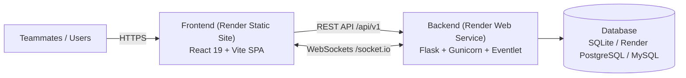

# Complete Render Deployment Guide

This guide walks you and your teammates through deploying the **Alumni Connect Portal** on [Render](https://render.com) so that anyone on the team can access, test, and build upon the live application.

---

## Architecture on Render



- **Frontend (Static Site):** Free, fast CDN edge hosting, automatic SPA rewrites (`_redirects`).
- **Backend (Web Service):** Python runtime with Gunicorn + Eventlet for WebSocket support.
- **Database:** Auto-initialized SQLite (zero setup) or Render PostgreSQL / external MySQL.
- **Auto-Seeding:** On first launch, demo accounts (Admin, Alumni, Student) are automatically populated so teammates can log in immediately.

---

## Method 1: Automated Blueprint Deployment (Recommended)

The repository includes a `render.yaml` Blueprint file that configures both frontend and backend automatically.

### Step 1: Push the latest code to GitHub
Ensure all code and the `render.yaml` file are pushed to your GitHub repository:
```bash
git add .
git commit -m "feat: configure render deployment blueprint and auto-seed"
git push origin main
```

### Step 2: Open Render Dashboard
1. Go to [dashboard.render.com](https://dashboard.render.com) and log in.
2. Click **New +** in the top right corner and choose **Blueprint**.
3. Connect your GitHub account and select the **`-Alumni-Connect-Portal`** repository.
4. Render will parse `render.yaml` and display the two services to be created:
   - `alumni-connect-backend` (Web Service)
   - `alumni-connect-frontend` (Static Site)
5. Click **Apply**.

### Step 3: Link Frontend to Backend
1. Once the backend finishes building, copy its live Render URL (e.g., `https://alumni-connect-backend-xxxx.onrender.com`).
2. Go to your **`alumni-connect-frontend`** service on Render.
3. Open **Environment** in the left menu.
4. Set `VITE_API_BASE_URL` to:
   ```
   https://alumni-connect-backend-xxxx.onrender.com/api/v1
   ```
5. Click **Save Changes** and click **Manual Deploy > Clear build cache & deploy**.

---

## Method 2: Manual Step-by-Step Deployment

If you prefer to configure the services manually on Render:

### Part A: Deploy the Backend (Web Service)

1. In Render Dashboard, click **New +** > **Web Service**.
2. Connect your GitHub repository: `https://github.com/rajeevkaroshe2005/-Alumni-Connect-Portal.git`.
3. Configure the following settings:
   - **Name:** `alumni-connect-backend`
   - **Root Directory:** `backend`
   - **Environment / Runtime:** `Python 3`
   - **Build Command:** `pip install -r requirements.txt`
   - **Start Command:** `gunicorn --worker-class eventlet -w 1 --bind 0.0.0.0:$PORT run:app`
   - **Plan:** Free
4. Under **Environment Variables**, add:
   | Key | Value | Description |
   |---|---|---|
   | `FLASK_ENV` | `production` | Enables production security configs |
   | `SECRET_KEY` | *(Click "Generate" or enter random 32+ chars)* | Session encryption key |
   | `JWT_SECRET_KEY` | *(Click "Generate" or enter random 32+ chars)* | JWT token signing key |
   | `CORS_ORIGINS` | `*` | Allows requests from your frontend |
   | `AUTO_SEED` | `true` | Automatically seeds demo accounts if DB is empty |
   | `USE_SQLITE` | `true` | Uses built-in SQLite (or set `DATABASE_URL` if using Postgres) |
5. Under **Advanced**, set **Health Check Path** to:
   ```
   /api/health
   ```
6. Click **Create Web Service**.
7. Wait 2–3 minutes until the deployment status turns green (**Live**). Note your backend URL (e.g., `https://alumni-connect-backend.onrender.com`).

---

### Part B: Deploy the Frontend (Static Site)

1. In Render Dashboard, click **New +** > **Static Site**.
2. Select the same GitHub repository.
3. Configure the following settings:
   - **Name:** `alumni-connect-frontend`
   - **Root Directory:** `frontend`
   - **Build Command:** `npm install && npm run build`
   - **Publish Directory:** `dist`
4. Under **Environment Variables**, add:
   | Key | Value |
   |---|---|
   | `VITE_API_BASE_URL` | `https://<your-backend-url>.onrender.com/api/v1` |
5. Under **Redirects/Rewrites**:
   - The included `frontend/public/_redirects` file automatically handles SPA rewrites (`/* -> /index.html 200`).
   - If setting manually in the dashboard:
     - **Type:** `Rewrite`
     - **Source:** `/*`
     - **Destination:** `/index.html`
6. Click **Create Static Site**.
7. Within 1–2 minutes, your frontend will be live on a `*.onrender.com` URL!

---

## Pre-Seeded Accounts for Teammates

Once deployed, your teammates can immediately log in with any of these pre-seeded accounts:

| Role | Email | Password | Features to Test |
|---|---|---|---|
| **Platform Admin** | `admin@alumniportal.edu` | `Password123!` | User approvals, verification badges, audit logs, system stats |
| **Alumni (Google)** | `priya.sharma@alumni.edu` | `Password123!` | Job posting, mentorship availability slots, project creation |
| **Alumni (Amazon)** | `rahul.verma@alumni.edu` | `Password123!` | Mock interviews, referral request review, messaging |
| **Student (CSE)** | `aarav.patel@student.edu` | `Password123!` | Book mentorship session, apply to jobs, AI resume scan |
| **Student (ECE)** | `sneha.kulkarni@student.edu` | `Password123!` | AI career pathway generator, networking graph, donations |

Teammates can also click **Register** to create their own custom accounts anytime.

---

## Verifying Deployment Health

1. **Backend Health Check:**
   Open `https://<your-backend-url>.onrender.com/api/health` in your browser. You should see:
   ```json
   {
     "status": "healthy",
     "service": "Alumni Connect Portal API",
     "version": "1.0.0"
   }
   ```
2. **Frontend Test:**
   Open `https://<your-frontend-url>.onrender.com` in your browser.
   - Verify the landing page loads with styles and animations.
   - Navigate to `/login` and sign in with `admin@alumniportal.edu` / `Password123!`.
   - Verify dashboard widgets, directory, and jobs load properly.

---

## Free-Tier Keep-Alive Note

Render spins down free-tier Web Services after 15 minutes of inactivity. When a teammate opens the website after inactivity, the first backend request may take ~30–50 seconds while the server spins up (cold start). Subsequent requests will be instant.

To keep it awake for presentations or active collaboration, you can set up a free monitor using [UptimeRobot](https://uptimerobot.com) or [Cron-Job.org](https://cron-job.org) targeting `https://<your-backend-url>.onrender.com/api/health` every 10 minutes.
