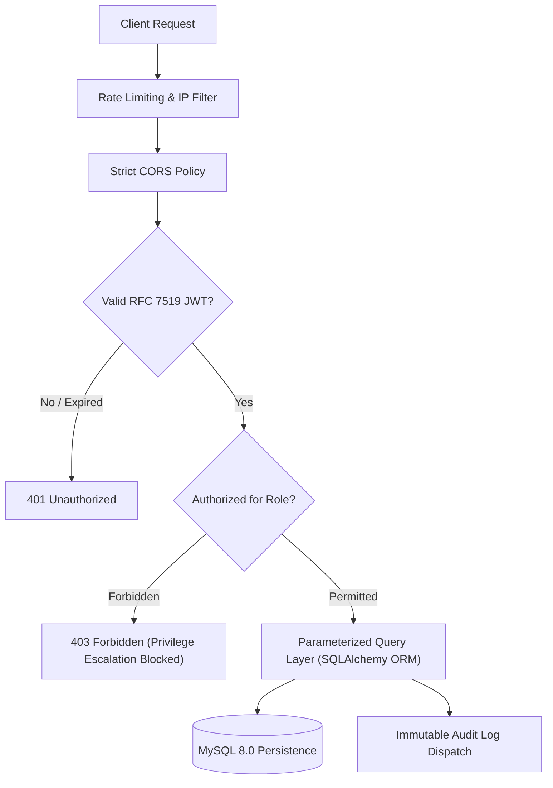

# Security Architecture & Compliance Engineering
## Alumni Connect Portal — AI-Powered Alumni Networking, Mentorship & Career Platform

---

### 1. Threat Model & Security Posture

The **Alumni Connect Portal** enforces an institutional **Deny-by-Default** security posture. No client-supplied role, identity, or permission claim is trusted without strict cryptographic and database session verification on the server.



---

### 2. Authentication & Cryptography

#### 2.1 Password Hashing & Key Derivation
* **Algorithm:** `bcrypt` key derivation function with an adaptive cost factor (`log_rounds = 12`).
* **Salt Handling:** A cryptographically secure random 128-bit salt is generated automatically per password, eliminating rainbow table attacks.
* **Storage:** Passwords are never stored in plaintext, log files, or session storage. The generated 60-character bcrypt hash is written directly to `users.password_hash`.

#### 2.2 RFC 7519 JSON Web Token (JWT) Standards
* **Signature Algorithm:** HMAC with SHA-256 (`HS256`) signed with an uncommitted 256-bit cryptographically secure server secret key (`JWT_SECRET_KEY`).
* **Payload Structure:**
  ```json
  {
    "sub": "5",
    "role": "STUDENT",
    "email": "student@alumniportal.edu",
    "exp": 1793280000,
    "iat": 1793193600
  }
  ```
* **Strict Type Validation:** In adherence to RFC 7519 and PyJWT 2.15+, the `sub` claim is strictly validated as a string representation of the integer ID, preventing type confusion or spoofing attacks.
* **Token Expiration:** Access tokens have an enforced lifespan of 24 hours. Expired tokens are rejected unconditionally with a `401 Unauthorized` status.

---

### 3. Server-Side Authorization & Role-Based Access Control (RBAC)

* **Deny-by-Default Decorators:**
  - `@jwt_required`: Validates token presence, format, and signature. Populates `request.user_id`, `request.user_role`, and `request.user_email`.
  - `@roles_required(*roles)`: Verifies that the authenticated user's role matches one of the authorized roles (`STUDENT`, `ALUMNI`, `ADMIN`).
* **Privilege Escalation Prevention:**
  - When creating or modifying sensitive resources (e.g., jobs, mentorship slots, event RSVP), the user ID is extracted strictly from the verified JWT context (`request.user_id`), completely ignoring any caller-supplied `user_id` or `author_id` in request payloads.
  - Administrative endpoints (`/api/v1/admin/*`) reject any request that does not carry an authentic `ADMIN` role claim verified against the active user database record.

---

### 4. Input Sanitization & Injection Defense

* **SQL Injection (SQLi):**
  - All database queries are executed via **SQLAlchemy 2.0 ORM** using prepared statements and parameterized inputs. No raw SQL concatenation is utilized anywhere in the application.
* **Cross-Site Scripting (XSS):**
  - React's virtual DOM automatically encodes all rendered data expressions prior to DOM insertion, neutralizing reflective and stored XSS vectors.
* **File Upload & In-Memory Resume Security:**
  - Uploaded resume files are restricted to `.pdf` and `.txt` extensions with a strict 5MB size limit.
  - Files are processed strictly **in-memory** through byte stream extraction without writing unencrypted documents to the server filesystem or retaining personal candidate text after skill extraction.

---

### 5. Concurrency & Anti-Double-Booking Protection

Mentorship session booking is vulnerable to race conditions if multiple students simultaneously attempt to book the same mentor slot. The portal defends against race conditions using:
1. **Pessimistic Row-Level Locking:** Acquires a lock on the target availability slot via `SELECT ... FOR UPDATE`.
2. **Transaction Isolation:** Uses nested atomic transactions (`db.session.begin_nested()`).
3. **Time-Interval Conflict Query:**
   ```sql
   SELECT COUNT(*) FROM mentorship_bookings
   WHERE mentor_id = :mentor_id
     AND status IN ('CONFIRMED', 'PENDING')
     AND session_time < :new_session_end
     AND DATE_ADD(session_time, INTERVAL 45 MINUTE) > :new_session_start;
   ```
4. If a conflict or prior reservation exists, the transaction rolls back cleanly, ensuring that zero double-bookings can occur.

---

### 6. Immutable Security Audit Trails

All sensitive institutional operations are logged immutably to the `audit_logs` database table via `AuditService.log()`:
* User registration and authentication events
* Alumni verification status changes (approved/rejected by administrator ID)
* User account suspensions and reinstatements
* Job posting creations and status updates
* Mentorship booking requests and final decisions
* Event scheduling and cancellations

Each log records the `actor_id`, `action`, `entity_type`, `entity_id`, metadata `details` (as structured JSON), client `ip_address`, and exact UTC `created_at` timestamp.
