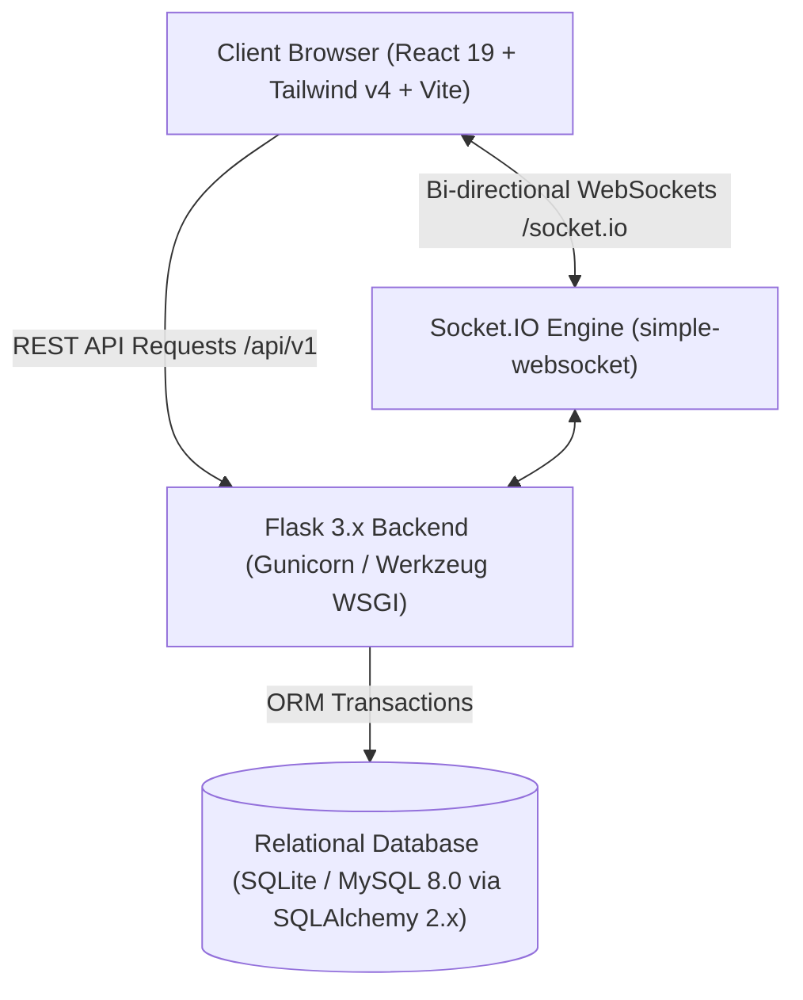

# Alumni Connect Portal — External Examination & Viva Guide 🎓

This comprehensive preparation guide covers system architecture, database schema, real-time data flows, and sample examiner questions for the final project defense.

---

## 1. Project Overview & Core Architecture

The **Alumni Connect Portal** is an enterprise-grade web application connecting university students, verified alumni, and campus administrators.

- **Frontend:** React 19, Vite, Tailwind CSS v4, Lucide Icons, Framer Motion, Recharts.
- **Backend:** Flask 3.x, Flask-SQLAlchemy (SQLAlchemy 2.x), Flask-SocketIO (WebSocket), PyJWT (Auth), Bcrypt.
- **Database Engine:** Decoupled architecture supporting **SQLite** for embedded zero-config runtime and **MySQL 8.0 / PostgreSQL** for enterprise production.

---

## 2. Database Schema & Structure (24 Normalized Tables)

The schema adheres to 3rd Normal Form (3NF) to ensure data integrity and eliminate redundancy:

1. **Identity & Roles (4 Tables):**
   - `users`: Core authentication (`id`, `email`, `password_hash`, `role`, `is_active`).
   - `profiles`: Personal presentation (`user_id`, `first_name`, `last_name`, `headline`, `bio`, `skills`, `phone`, `location`).
   - `student_details`: Academic records (`roll_number`, `current_year`, `degree`, `department`, `expected_graduation_year`, `cgpa`).
   - `alumni_details`: Professional career milestones (`graduation_year`, `degree`, `current_company`, `current_position`, `verification_status`).

2. **Mentorship Engine (4 Tables):**
   - `mentor_profiles`: Mentorship capacity and expertise areas.
   - `mentor_availability_slots`: Discrete bookable calendar slots.
   - `mentorship_bookings`: Session lifecycle (`PENDING` -> `CONFIRMED` -> `COMPLETED`).
   - `mentorship_session_summaries`: Post-session action items and student ratings.

3. **Career & Opportunity Hub (3 Tables):**
   - `jobs`: Verified job openings, internships, salary ranges, deadlines.
   - `job_applications`: Application tracking with resume links and status pipeline.
   - `saved_jobs`: User bookmarked opportunities.

4. **Events & Digital QR Check-In (3 Tables):**
   - `events`: Campus lectures, reunions, and webinars.
   - `event_rsvps`: Tickets with unique verification check-in tokens.
   - `event_feedbacks`: Attendee ratings and qualitative reviews.

5. **Real-Time Communication (2 Tables):**
   - `messages`: Socket.IO chat history between students and alumni.
   - `notifications`: Real-time alerts for booking confirmations and application updates.

6. **Community, Projects & Giving (7 Tables):**
   - `collaboration_projects` & `project_applications`: Student-alumni co-founding & research.
   - `alumni_achievements` & `achievement_cheers`: Career promotion wall and claps.
   - `skill_endorsements`: Mutual relationship verified endorsements.
   - `donation_campaigns` & `donation_transactions`: Department crowdfunding and transparent receipt ledger.

7. **Security & Auditing (1 Table):**
   - `audit_logs`: Immutable security trail tracking administrative operations.

---

## 3. Real-Time Data Flow (WebSockets vs. REST)

| Communication Type | Protocol | Technology | Use Case |
|---|---|---|---|
| **Real-Time Bidirectional** | WebSocket | Flask-SocketIO (`simple-websocket`) | Peer-to-peer chat, live notification badges |
| **Transactional REST** | HTTPS | Flask Blueprints + JSON | User registration, job creation, profile editing |
| **Storage Persistence** | SQL | SQLAlchemy ORM | Atomic transactions with ACID guarantees |

---

## 4. Top 10 Examiner Questions & Confident Answers

### Q1: What makes your application "Real-Time"?
> **Answer:** *"The application integrates Flask-SocketIO using WebSockets. When a student sends a chat message or receives a notification, the server broadcasts an event over an open persistent TCP connection directly to the recipient's browser, updating the DOM instantaneously without polling or page reloads."*

### Q2: Why did you separate `users` from `profiles` and `student_details`?
> **Answer:** *"This implements table normalization (3NF) and the Role-Based Entity Pattern. The `users` table handles authentication (email, password hash, role), while `profiles` holds personal bio and contact info. Specific domain attributes like `roll_number` and `cgpa` belong to `student_details`, whereas `current_company` belongs to `alumni_details`. This prevents NULL-heavy sparse tables."*

### Q3: How is password security handled?
> **Answer:** *"Passwords are never stored in plaintext. We use bcrypt with a salt factor of 12 rounds (`gensalt(12)`). Bcrypt is intentionally compute-heavy to defend against brute-force and rainbow table attacks."*

### Q4: How is authentication managed across requests?
> **Answer:** *"We use stateless JSON Web Tokens (JWT) signed with HMAC-SHA256. Upon login, the client receives a token stored in browser localStorage and sent via the `Authorization: Bearer <token>` HTTP header. Protected routes use custom `@jwt_required` and `@roles_required` Python decorators to verify permissions."*

### Q5: Can the application scale to multiple database engines?
> **Answer:** *"Yes. Because we use SQLAlchemy as an Object-Relational Mapper (ORM), the Python code remains identical whether executing against SQLite for local embedded development, or MySQL and PostgreSQL for enterprise cloud deployment."*
